(wavefield-snapshots)=
# 二维波场快照：六类波动方程

同一个三层模型、同一个震源质心和三个观测时刻，查看 Acoustic、Elastic、VTI、VRZ、VRR 和 GSLS 的传播形态。本页给出各自的基础方程、场变量、参考文献与实际计算结果。

```{important}
本页图像是 **2026-10-18 的 CPU 实算结果**，源码基线为 `391f4a45efdee2f88a9d1432997fdca20ecd2d6f`。发布时未重跑 PDE，也未将历史结果改称为最新 dev 或 CUDA 实测。配套 CUDA Notebook 与 Python 文件没有嵌入 GPU 输出，尚无 CUDA 数值验收；它们是另行运行的复现入口。
```

## 共同模型与采样

物理区域为 2.0 km × 1.6 km，网格为 401 × 321 个节点，Δx = Δz = 5 m。界面中心深度为 650 / 1100 m，以 tanh 过渡，半宽参数 15 m。全部边界为 30 格 PML，无自由表面；图中不显示 PML。

| 参数 | 上层 | 中层 | 下层 |
|---|---:|---:|---:|
| Vp（m/s） | 1800 | 2300 | 2800 |
| Vs（m/s，仅弹性） | 1000 | 1300 | 1600 |
| ρ（kg/m³） | 1900 | 2150 | 2400 |
| VTI ε | 0.18 | 0.22 | 0.26 |
| VTI δ | 0.06 | 0.08 | 0.10 |
| GSLS 名义 Q₀ | 30 | 30 | 30 |

震源质心 (x,z) = (1000,450) m，12 Hz Ricker 子波峰时为 0.10 s。四阶空间差分，用户 Δt = 0.0005 s，1002 个源样本。快照时刻是从模拟起点计算的 **0.20 / 0.35 / 0.50 s**，不是从源峰时起算。末尾的额外采样用于弹性半时间步配准。Scalar 恒密度方程不读取该密度模型。


```{raw} html
<figure class="sw-example-figure">
  <div class="sw-example-viewport" tabindex="0" role="region" aria-label="可左右滚动查看完整图">
    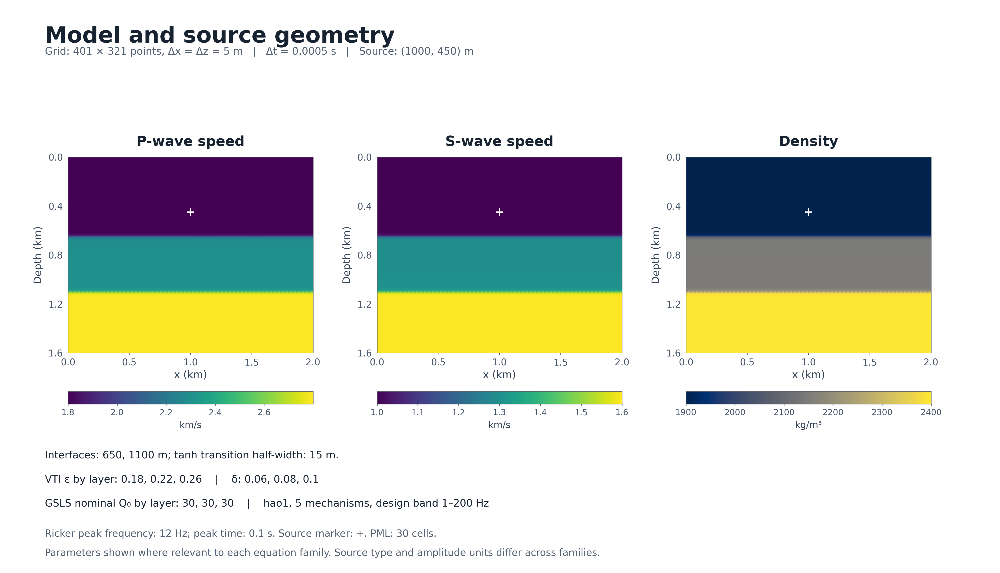
  </div>
  <figcaption>共同的物理模型、界面与震源几何。Vs 仅用于弹性。 <a href="../_static/wavefield2d/model_context.png">PNG</a> · <a href="../_static/wavefield2d/model_context.pdf">PDF</a> · <a href="../_static/wavefield2d/model_context.svg">SVG</a></figcaption>
</figure>
```


## 怎样读图

所有线性主图采用每个方程单独的 A = max|field|，最大值跨三个时刻计算；同一行固定 A，显示 field/A，不逐帧归一化、不按百分位截幅。不同方程的源单位和场变量不同，**不能按行间颜色亮度比较绝对物理振幅**。Pa 标签基于选定的强迫单位，并非实际震源标定。

非弹性数据来自物理节点上的密集接收记录。弹性竖向速度仍位于 z = (j+½)Δz 的交错面，使用相邻半时刻记录平均到公共整时刻；空间位置没有被伪装成节点。坐标 x 为水平、z 为深度，∇=(∂x,∂z)。以下公式是物理域内部的连续方程，省略 PML 辅助变量；有限差分、交错存储与源注入规则仍以各入口实现为准。


```{raw} html
<figure class="sw-example-figure">
  <div class="sw-example-viewport" tabindex="0" role="region" aria-label="可左右滚动查看完整图">
    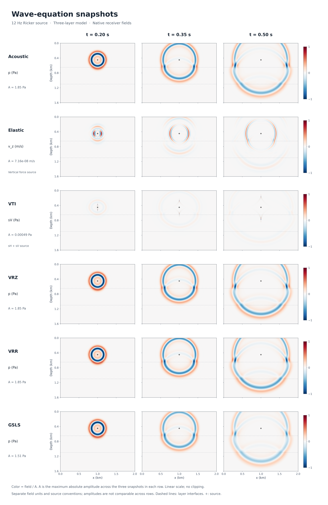
  </div>
  <figcaption>总览：同一行比较演化；跨行仅比较形态与场变量差异。 <a href="../_static/wavefield2d/six_equation_snapshots.png">PNG</a> · <a href="../_static/wavefield2d/six_equation_snapshots.pdf">PDF</a> · <a href="../_static/wavefield2d/six_equation_snapshots.svg">SVG</a></figcaption>
</figure>
```


## 1. Acoustic：恒密度标量声学

```{math}
\partial_t^2p=v_p^2(\partial_x^2p+\partial_z^2p-f).
```

p 为压力（Pa），v_p 为模型速度（m/s），f 为网格点二阶强迫（Pa/m²）。速度可以随空间变化，密度为常数。源注入为 −v_source²Δt_internal² f，不是直接添加压力。该模型描述压缩波与速度变化引起的反射、折射，不含弹性 S 波。实现对应 `starwave/scalar.py` 及其标量传播内核。


```{raw} html
<figure class="sw-example-figure sw-wavefield-family" data-family="acoustic">
  <div class="sw-example-viewport" tabindex="0" role="region" aria-label="Acoustic：0.20、0.35、0.50 s 波场，左右滚动查看">
    <div class="sw-wavefield-row">
    <a href="../_static/wavefield2d/panels/acoustic_t0200ms.png">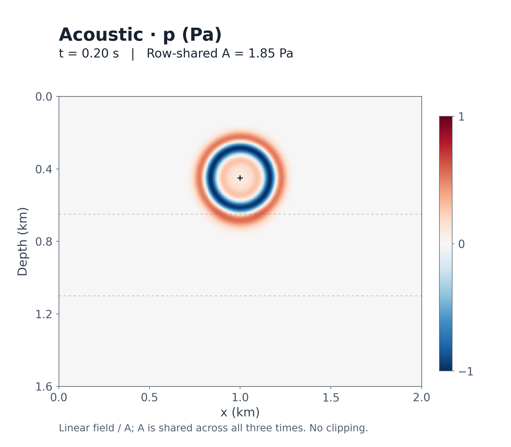</a>
    <a href="../_static/wavefield2d/panels/acoustic_t0350ms.png">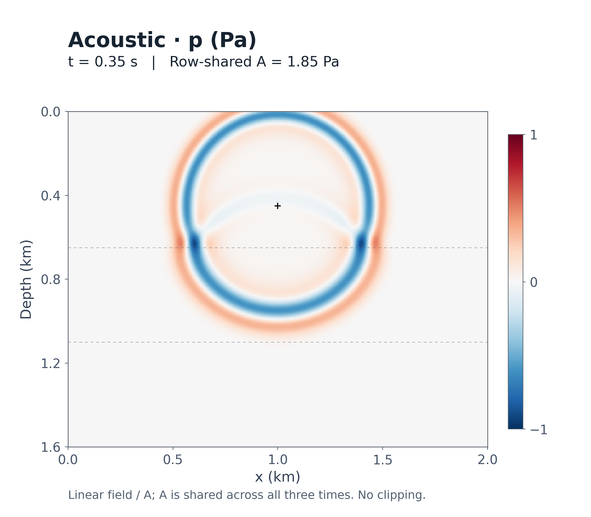</a>
    <a href="../_static/wavefield2d/panels/acoustic_t0500ms.png">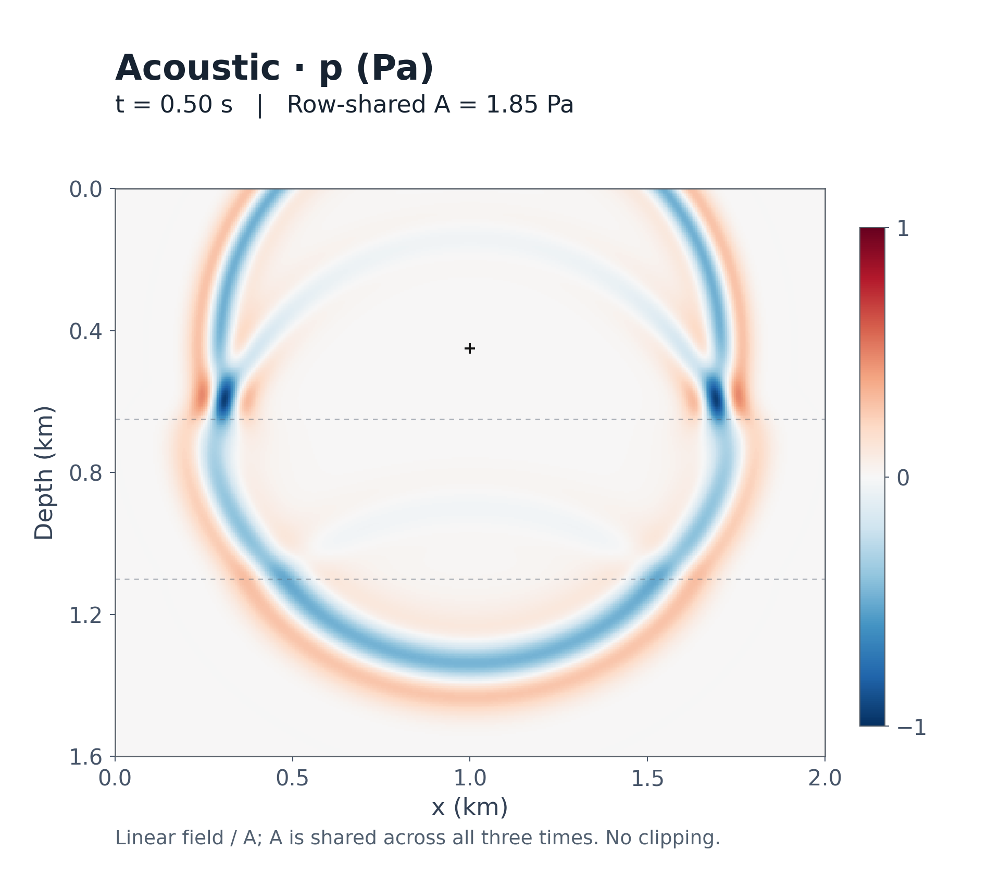</a>
    </div>
  </div>
  <figcaption>压力场的传播、界面反射与透射。密度在此方程中恒定。 <a href="../_static/wavefield2d/data/acoustic_snapshots.npz">原始 NPZ</a> · <a href="../_static/wavefield2d/data/acoustic_metadata.json">运行元数据</a></figcaption>
</figure>
```


## 2. Elastic：各向同性弹性

```{math}
\begin{aligned}
\rho\partial_t v_x&=\partial_x\sigma_{xx}+\partial_z\sigma_{xz}+b_x,\\
\rho\partial_t v_z&=\partial_x\sigma_{xz}+\partial_z\sigma_{zz}+b_z,\\
\partial_t\sigma_{xx}&=(\lambda+2\mu)\partial_xv_x+\lambda\partial_zv_z,\\
\partial_t\sigma_{zz}&=\lambda\partial_xv_x+(\lambda+2\mu)\partial_zv_z,\\
\partial_t\sigma_{xz}&=\mu(\partial_zv_x+\partial_xv_z),\\
\mu&=\rho v_s^2,\qquad\lambda=\rho(v_p^2-2v_s^2).
\end{aligned}
```

σ 与拉梅参数 λ、μ 的单位为 Pa，v_x、v_z 为粒子速度（m/s），b 为体力密度（N/m³）。竖向力源可激发 P、SV 运动，界面可产生模式转换；观测量为 v_z（二维 API 名 `v_y`），波瓣与极性受力源方向和速度分量影响。[Virieux (1986)](https://doi.org/10.1190/1.1442147) 给出经典速度–应力交错网格方法；实现与 [Deepwave 弹性方程说明](https://ausargeo.com/deepwave/elastic) 对应。

源等分到 z=447.5 / 452.5 m 两个交错面，源样本取 (k−½)Δt；接收记录 k 与 k+1 平均后对应 kΔt。这只是时间配准，保留 320 个深度面的位置。


```{raw} html
<figure class="sw-example-figure sw-wavefield-family" data-family="elastic">
  <div class="sw-example-viewport" tabindex="0" role="region" aria-label="Elastic：0.20、0.35、0.50 s 波场，左右滚动查看">
    <div class="sw-wavefield-row">
    <a href="../_static/wavefield2d/panels/elastic_t0200ms.png">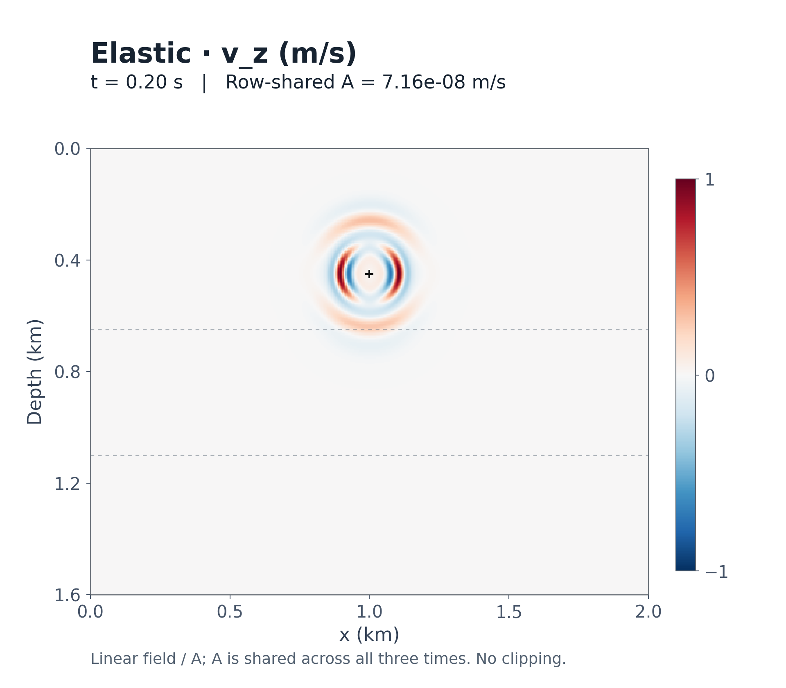</a>
    <a href="../_static/wavefield2d/panels/elastic_t0350ms.png">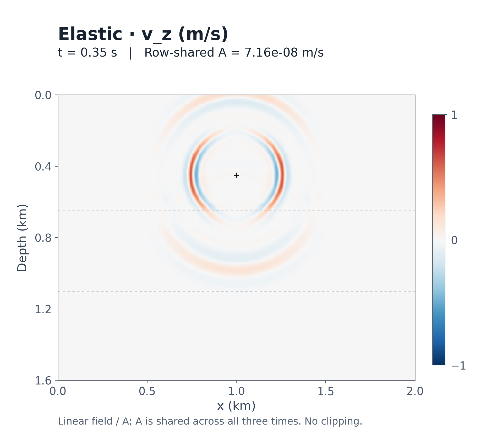</a>
    <a href="../_static/wavefield2d/panels/elastic_t0500ms.png">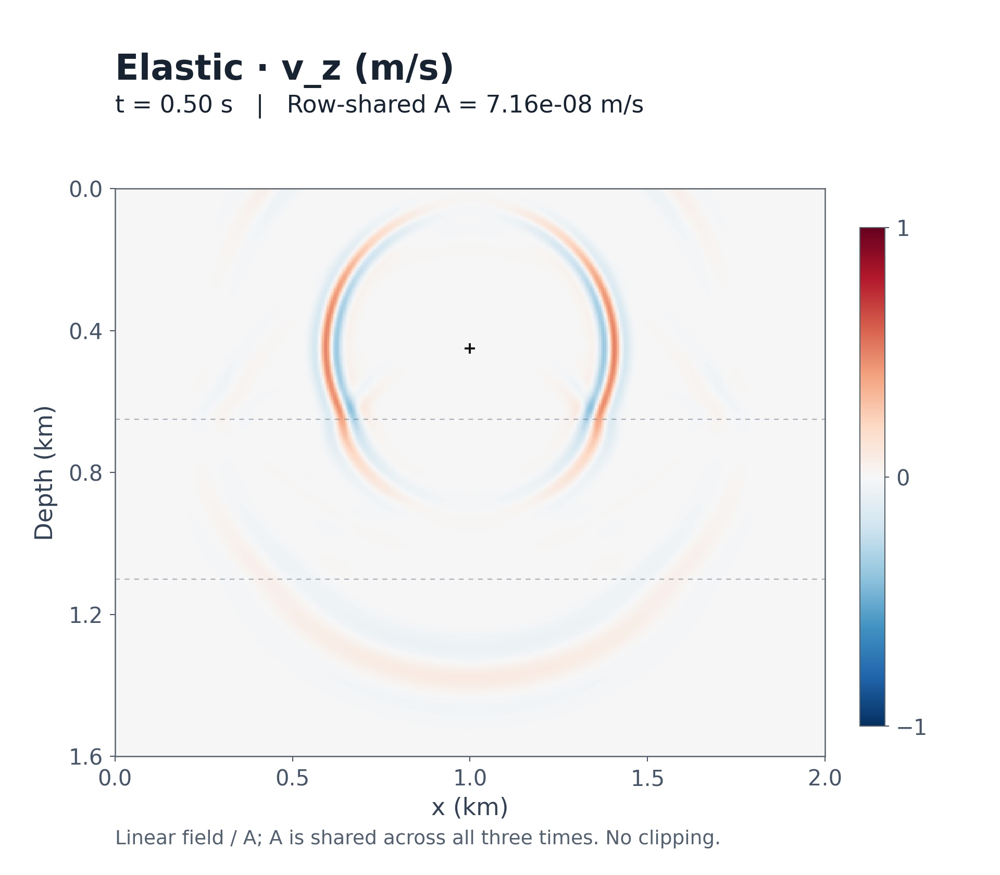</a>
    </div>
  </div>
  <figcaption>竖向粒子速度，竖向力源；P/S 波解释来自传播形态，未作模态分解。 <a href="../_static/wavefield2d/data/elastic_snapshots.npz">原始 NPZ</a> · <a href="../_static/wavefield2d/data/elastic_metadata.json">运行元数据</a></figcaption>
</figure>
```


## 3. VTI：垂直对称轴伪声系统

```{math}
\begin{aligned}
\rho\partial_t v_x&=\partial_xs_H,\qquad\rho\partial_t v_z=\partial_zs_V,\\
\partial_t s_H&=c_{11}\partial_xv_x+c_{13}\partial_zv_z+q_H,\\
\partial_t s_V&=c_{13}\partial_xv_x+c_{33}\partial_zv_z+q_V,\\
c_{11}&=\rho v_p^2(1+2\epsilon),\quad c_{33}=\rho v_p^2,\quad
c_{13}=\rho v_p^2\sqrt{1+2\delta}.
\end{aligned}
```

v_p 为垂直 P 波速度，ε、δ 为无量纲参数。q_H=q_V 是应力率（Pa/s），通过 +Δt 同时注入 s_H、s_V；图中记录 s_V（Pa）。这是 [Duveneck 等 (2008)](https://doi.org/10.1190/1.3059320) 一类零剪切伪声系统，不是完整弹性 VTI；它可保留 qSV 型次级分支，并不使用物理 v_s 模型。精确系数与正号按本次实现核对。


```{raw} html
<figure class="sw-example-figure sw-wavefield-family" data-family="vti">
  <div class="sw-example-viewport" tabindex="0" role="region" aria-label="VTI：0.20、0.35、0.50 s 波场，左右滚动查看">
    <div class="sw-wavefield-row">
    <a href="../_static/wavefield2d/panels/vti_t0200ms.png">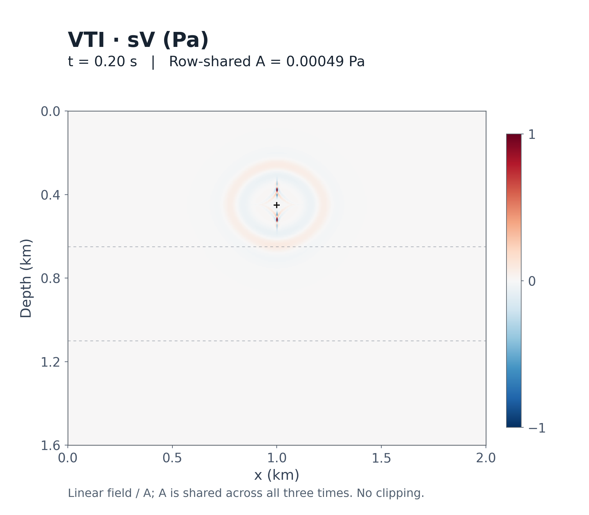</a>
    <a href="../_static/wavefield2d/panels/vti_t0350ms.png">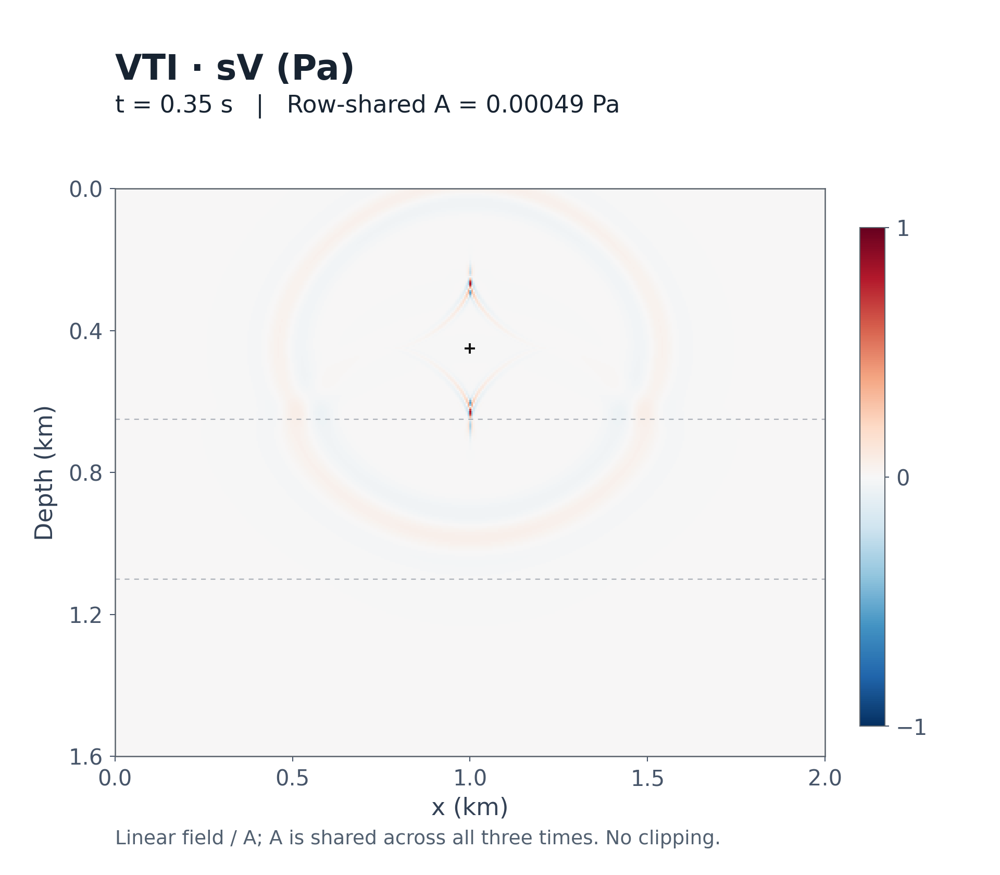</a>
    <a href="../_static/wavefield2d/panels/vti_t0500ms.png">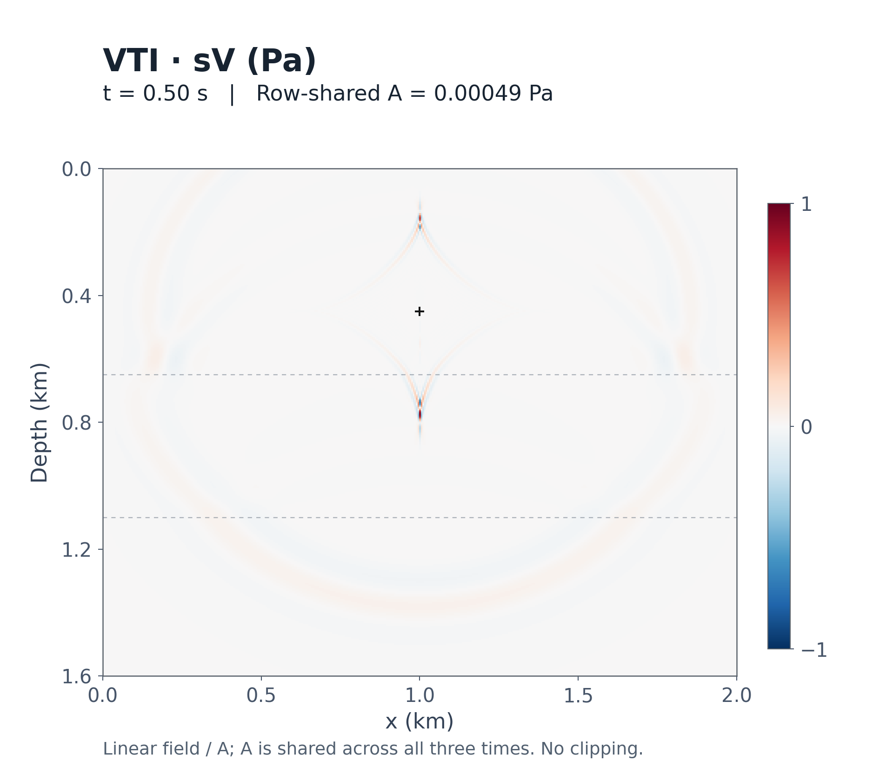</a>
    </div>
  </div>
  <figcaption>竖向伪声应力，sH/sV 同时激发。保留慢内支，不将其当作真实弹性 S 波。 <a href="../_static/wavefield2d/data/vti_snapshots.npz">原始 NPZ</a> · <a href="../_static/wavefield2d/data/vti_metadata.json">运行元数据</a></figcaption>
</figure>
```


仅把 ε、δ 改为零，其他速度、密度、源、网格、时间和 PML 保持不变，得到下方各向同性对照。两行共用 A，采用明确标出的有符号平方根颜色映射以显示弱分支。它支持慢内支与各向异性伪声系统有关的解释；未对原非均匀波场作模态投影，不能将该慢支视为真实弹性 S 波。


```{raw} html
<figure class="sw-example-figure">
  <div class="sw-example-viewport" tabindex="0" role="region" aria-label="可左右滚动查看完整图">
    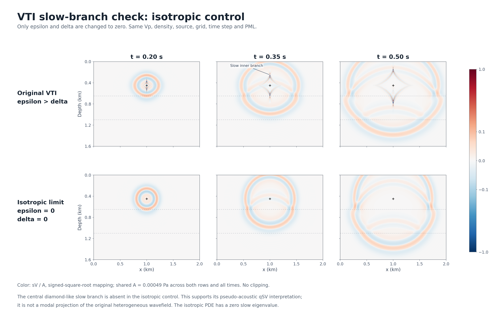
  </div>
  <figcaption>VTI 各向同性极限对照；慢支解释没有经过完整模态分解。 <a href="../_static/wavefield2d/vti_isotropic_control.png">PNG</a> · <a href="../_static/wavefield2d/vti_isotropic_control.pdf">PDF</a> · <a href="../_static/wavefield2d/vti_isotropic_control.svg">SVG</a></figcaption>
</figure>
```


## 4. VRZ：变密度声学

```{math}
\begin{aligned}
\partial_t^2p&=v_pZ\nabla\!\cdot\!\left(\frac{v_p}{Z}\nabla p\right)-v_p^2f\\
&=v_p^2\Delta p+\left[v_p\nabla v_p+v_p^2Z\nabla(Z^{-1})\right]\!\cdot\!\nabla p-v_p^2f,\qquad Z=\rho v_p.
\end{aligned}
```

Z=ρv_p 为阻抗，ρ>0。对光滑模型，等价于变密度形式 ∂²_t p=ρv_p²∇·(ρ⁻¹∇p)−v_p²f。实际内核采用展开乘积式有限差分，不是面通量离散；不能假设离散链式法则精确成立。速度–阻抗变换见 [Whitmore 等 (2020)，式 1–3](https://doi.org/10.3997/2214-4609.202010332)。


```{raw} html
<figure class="sw-example-figure sw-wavefield-family" data-family="vrz">
  <div class="sw-example-viewport" tabindex="0" role="region" aria-label="VRZ：0.20、0.35、0.50 s 波场，左右滚动查看">
    <div class="sw-wavefield-row">
    <a href="../_static/wavefield2d/panels/vrz_t0200ms.png"></a>
    <a href="../_static/wavefield2d/panels/vrz_t0350ms.png"></a>
    <a href="../_static/wavefield2d/panels/vrz_t0500ms.png"></a>
    </div>
  </div>
  <figcaption>变密度压力场，由 Vp 与密度共同控制反射和透射。 <a href="../_static/wavefield2d/data/vrz_snapshots.npz">原始 NPZ</a> · <a href="../_static/wavefield2d/data/vrz_metadata.json">运行元数据</a></figcaption>
</figure>
```


## 5. VRR：速度与矢量反射率

```{math}
\partial_t^2p=v_p^2\Delta p+\left(v_p\nabla v_p-2v_p^2\mathbf r\right)\!\cdot\!\nabla p-v_p^2f,\qquad\mathbf r=(r_x,r_z).
```

对光滑正阻抗，连续参数对应为 r=½∇ln Z=−½Z∇(1/Z)，单位 m⁻¹，不是无量纲界面反射系数。此例实际使用两层复制 halo，按四阶中心差分计算并裁去 halo：

```{math}
r_i=-\tfrac12ZD_i(Z^{-1}),\qquad
D_i g_j=\frac{\tfrac23(g_{j+1}-g_{j-1})-\tfrac1{12}(g_{j+2}-g_{j-2})}{h}.
```

不能把这一步替换为 ½D_i(log Z)。API 接收独立、静态的 r_x/r_z，传播标量 p，不重建或传播某个阻抗势；任意输入也未必来自正阻抗场。方程对应 [Whitmore 等 (2020)，式 4–5](https://doi.org/10.3997/2214-4609.202010332)。


```{raw} html
<figure class="sw-example-figure sw-wavefield-family" data-family="vrr">
  <div class="sw-example-viewport" tabindex="0" role="region" aria-label="VRR：0.20、0.35、0.50 s 波场，左右滚动查看">
    <div class="sw-wavefield-row">
    <a href="../_static/wavefield2d/panels/vrr_t0200ms.png">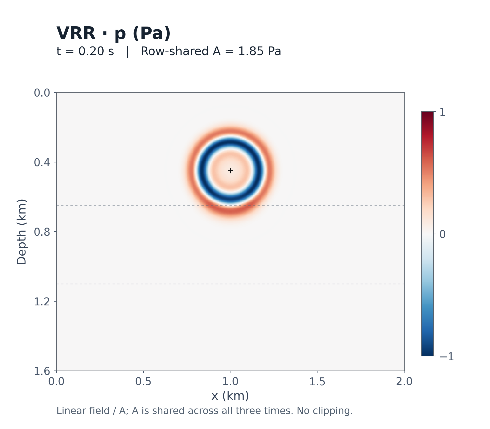</a>
    <a href="../_static/wavefield2d/panels/vrr_t0350ms.png">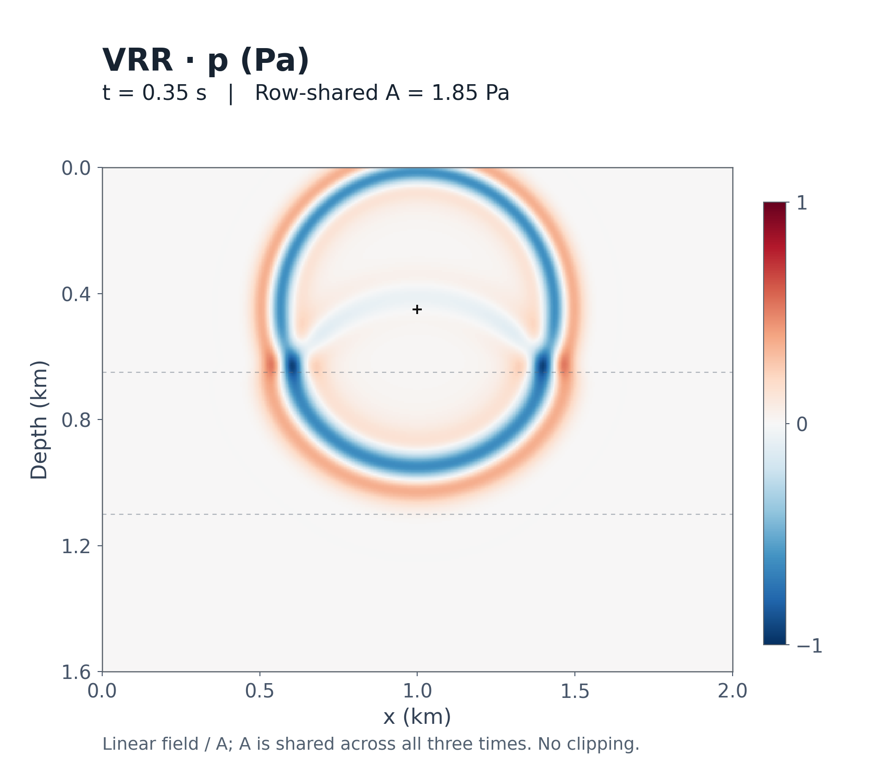</a>
    <a href="../_static/wavefield2d/panels/vrr_t0500ms.png">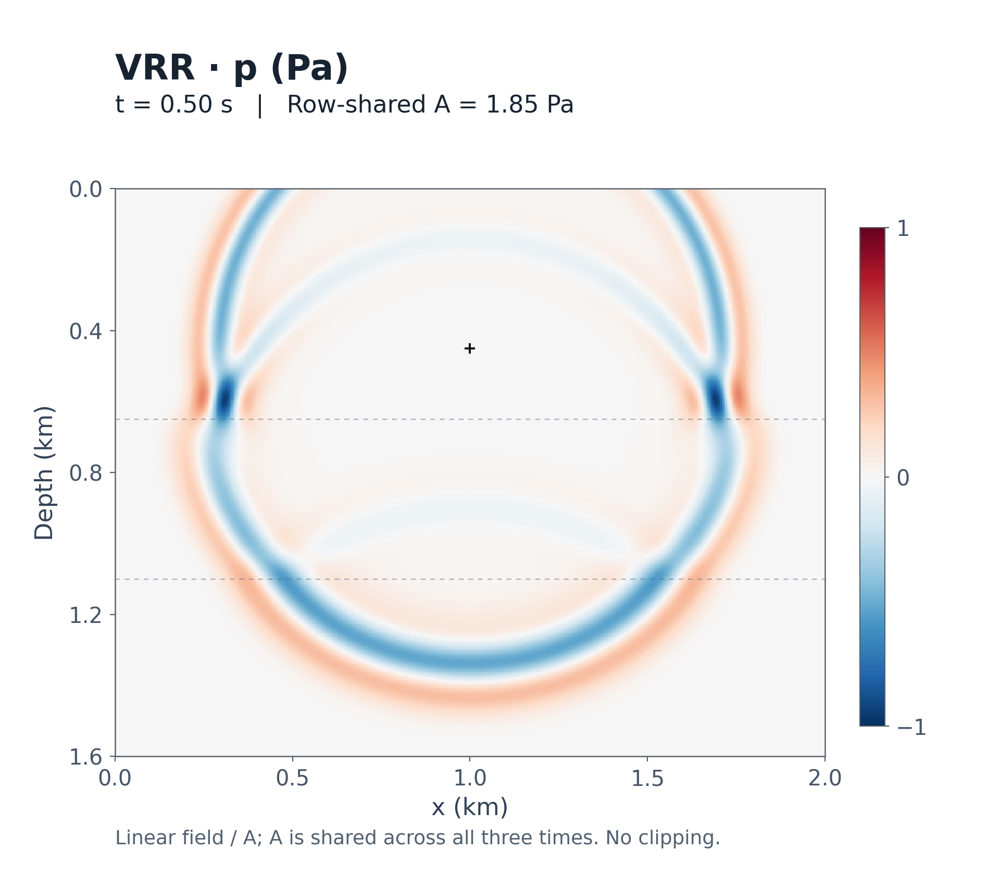</a>
    </div>
  </div>
  <figcaption>由速度和矢量反射率传播的标量压力场。反射率从共同阻抗离散构造。 <a href="../_static/wavefield2d/data/vrr_snapshots.npz">原始 NPZ</a> · <a href="../_static/wavefield2d/data/vrr_metadata.json">运行元数据</a></figcaption>
</figure>
```


这组实验由同一个阻抗 Z = ρVp 构造系数，因而 VRZ / VRR 快照接近。三个时刻的实测相对 L2 差约为 1.57×10⁻⁵ / 3.80×10⁻⁵ / 7.49×10⁻⁵。连续变换成立不意味着任意离散、PML 与边界实现完全相同，也不意味着 VRR 是 VRZ 的别名。

## 6. GSLS：多机制黏声与衰减

```{math}
\begin{aligned}
\mathcal D_\rho p&=\rho\nabla\!\cdot(\rho^{-1}\nabla p),\\
\partial_t^2p&=c_{\mathrm{rel}}^2\left[\left(1+\sum_{l=1}^{L}a_l\right)\mathcal D_\rho p-\sum_{l=1}^{L}m_l-f\right],\\
\partial_t m_l&=(a_l\mathcal D_\rho p-m_l)/\tau_l.
\end{aligned}
```

这里用 m_l 表示材料记忆变量，以区别于 VRR 的矢量 r（实现中称 r_l）。a_l≥0 为无量纲强度，τ_l>0 的单位为 s，m_l 为 Pa/m²，c_rel 为松弛速度（m/s）。压力加速度中记忆项带负号，源缩放为 −c_rel²Δt² f，零初始条件下首个强迫样本取 f₀/2。

本例采用 **5 个机制、hao1**，即 [Hao 与 Greenhalgh (2021)](https://doi.org/10.1190/geo2020-0548.1) 的一阶逆 Q 参数化；“一阶”不是单机制，也不是一阶时间积分。设计频带 1–200 Hz，Q₀=30 为名义值，模型 Vp 在连续频域模型中精确对应参考频率 12 Hz 的相速度。实际 Q_eff(12 Hz)≈30.267；设计带内采样的最大相对逆 Q 误差约 9.03%，原 5% 默认拟合告警保留，不能称为精确恒 Q=30。

采用 exp(+iωt) 约定时，速度归一化与频响为：

```{math}
F(\omega)=1+\sum_l a_l\frac{i\omega\tau_l}{1+i\omega\tau_l},\qquad
Q_{\mathrm{eff}}=\frac{\Re F}{\Im F},\qquad
c_{\mathrm{rel}}^2=v_p^2\frac{|F_r|+\Re F_r}{2|F_r|^2},\quad F_r=F(2\pi f_{\mathrm{ref}}).
```

Q=∞ 时 a_l=0、c_rel=v_p，回到同一求解器的无衰减模型。


```{raw} html
<figure class="sw-example-figure sw-wavefield-family" data-family="gsls">
  <div class="sw-example-viewport" tabindex="0" role="region" aria-label="GSLS：0.20、0.35、0.50 s 波场，左右滚动查看">
    <div class="sw-wavefield-row">
    <a href="../_static/wavefield2d/panels/gsls_t0200ms.png">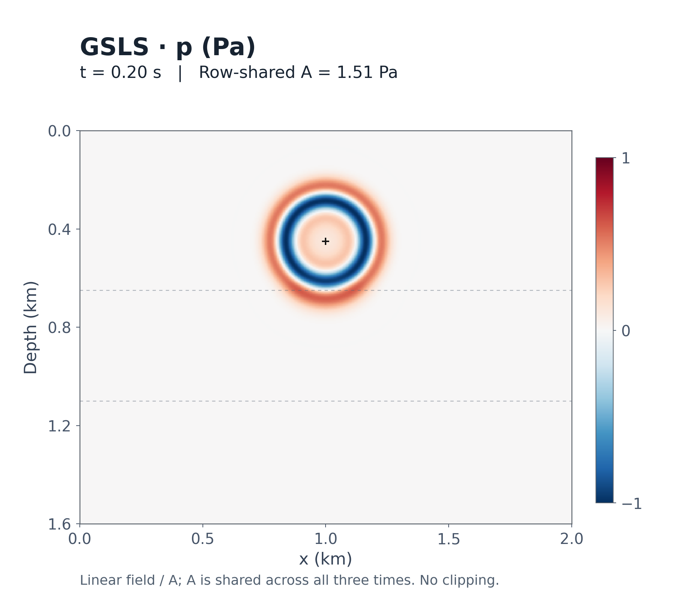</a>
    <a href="../_static/wavefield2d/panels/gsls_t0350ms.png">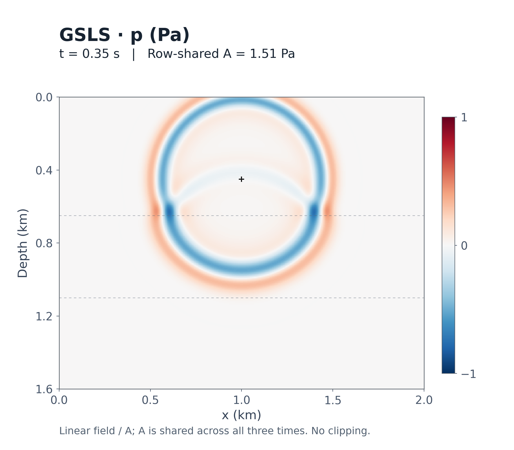</a>
    <a href="../_static/wavefield2d/panels/gsls_t0500ms.png">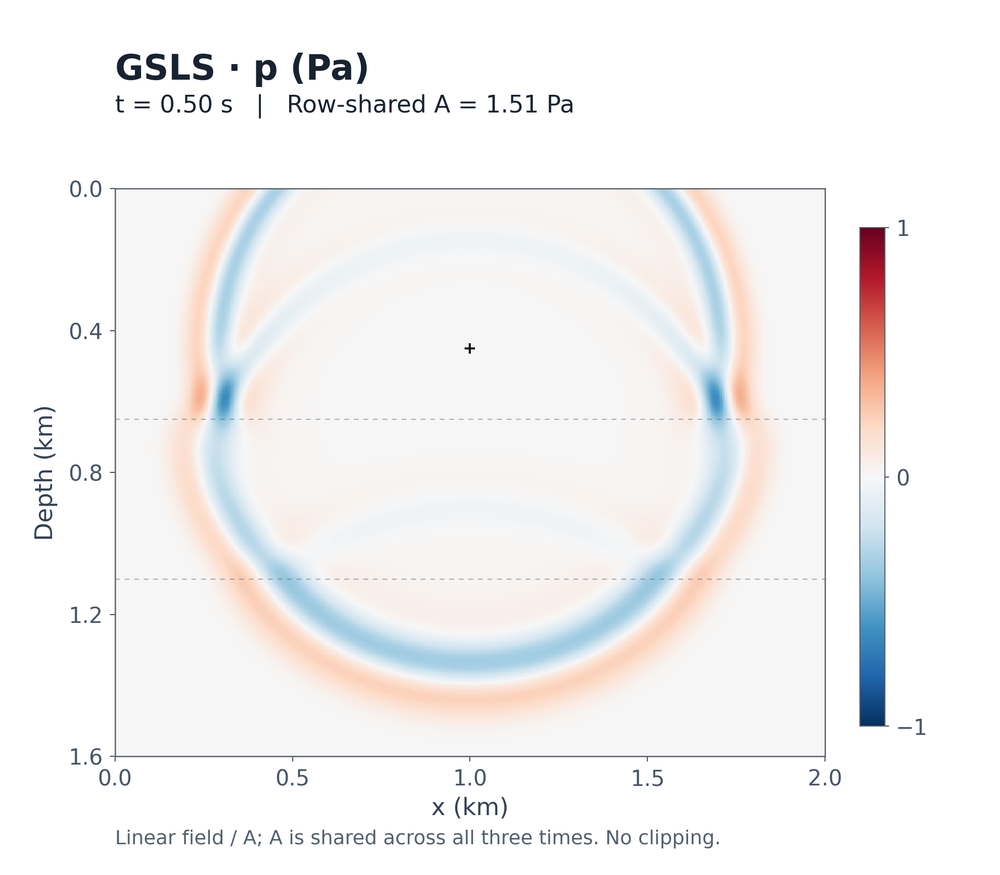</a>
    </div>
  </div>
  <figcaption>名义 Q0=30 的黏声压力场；每行归一化不能单独证明衰减。 <a href="../_static/wavefield2d/data/gsls_snapshots.npz">原始 NPZ</a> · <a href="../_static/wavefield2d/data/gsls_metadata.json">运行元数据</a></figcaption>
</figure>
```


衰减需要匹配对照判断。本例另运行同一 GSLS 求解器的 Q=∞ 情形，速度、密度、源和几何均保持一致。下图两个运行、三个时刻共用一个线性色标 A。全物理域压力场 L2 范数比（衰减 / 无衰减）为 0.829 / 0.699 / 0.597；这是场范数比，不是能量比，也不能单独用于反演 Q。


```{raw} html
<figure class="sw-example-figure">
  <div class="sw-example-viewport" tabindex="0" role="region" aria-label="可左右滚动查看完整图">
    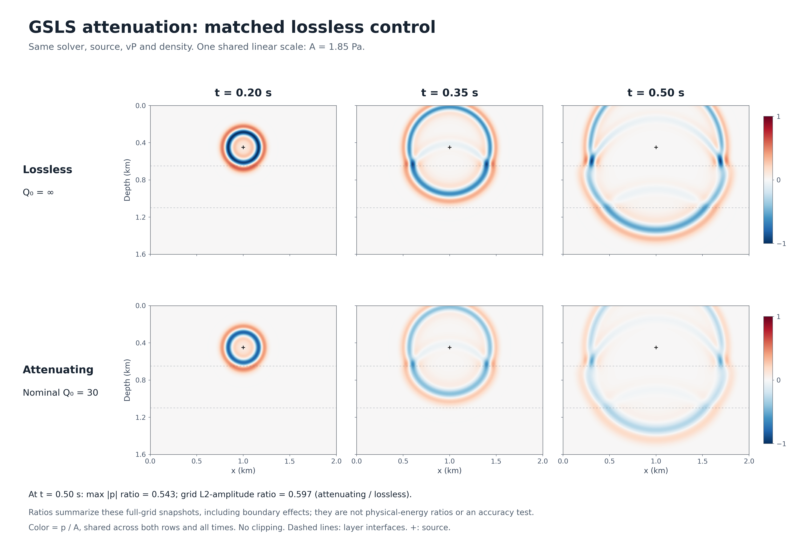
  </div>
  <figcaption>匹配的 GSLS 有衰减 / 无衰减实算控制。 <a href="../_static/wavefield2d/gsls_lossless_comparison.png">PNG</a> · <a href="../_static/wavefield2d/gsls_lossless_comparison.pdf">PDF</a> · <a href="../_static/wavefield2d/gsls_lossless_comparison.svg">SVG</a></figcaption>
</figure>
```


## 下载、复现与验证边界

- [CUDA Notebook](https://github.com/StarrMoonn/StarWave/blob/7c1743fe7791c7a52de6900a1ae67c9afe4d9548/notebook/WavefieldSnapshots/WavefieldSnapshots2D_All_CUDA.ipynb) · [同步 Python 文件](https://github.com/StarrMoonn/StarWave/blob/7c1743fe7791c7a52de6900a1ae67c9afe4d9548/notebook/WavefieldSnapshots/WavefieldSnapshots2D_All_CUDA.py)：先在所选 kernel 中安装并显式编译 StarWave，再顺序运行。脚本不自动安装、编译或回退 CPU。StarWave 源码仓库的链接需要相应访问权限。
- 每组快照下方提供本页实际 CPU 数据的 NPZ 与原始运行元数据。数组按 [time,z,x] 保存，Elastic 为 [3,320,401]，其余主方程为 [3,321,401]。保存数组独立于 CUDA Notebook 的运行状态。
- [模型参数](../_static/wavefield2d/data/config.json) · [数值设置检查](../_static/wavefield2d/data/validation_summary.json) · [GSLS 匹配指标](../_static/wavefield2d/data/gsls_comparison_metrics.json) · [无衰减数组](../_static/wavefield2d/data/gsls_lossless_snapshots.npz) · [VTI 控制数组](../_static/wavefield2d/data/vti_isotropic_control.npz) · [文件散列与来源](../_static/wavefield2d/manifest.json)
- CPU 运行采用 float32、单炮；Acoustic / VTI / VRZ / VRR / GSLS 使用 native_cpu，Elastic 使用公开 Torch CPU eager。已有源码及 CUDA 示例的小网格 CPU 兼容检查，不构成 GPU、全展示网格收敛或跨后端一致性验证。
- 原始 GSLS 元数据保留交付字节，其中通用源缩放文本 `−v²Δt²` 对 GSLS 不够精确；应按本页公式理解为 `−c_rel²Δt²`，首步半源约定保持不变。此勘误也记录在文件来源清单中。
- 本组检查了有限非零输出、轴序、源位置、时刻和稳定步长。没有完成解析解比对、网格收敛研究或完整伴随检验。30 Hz 时最小 S 波每波长约 6.67 格；Ricker 并非严格带限。VTI 与 Elastic 此配置的内部子步比为 1。
- PDF / SVG 的文字和轴为矢量元素，数值波场是嵌入的栅格图像。所有展示图片、原始数组和历史元数据均与已交付 CPU 结果逐字节一致。

## 参考文献与实现对应


1. Virieux, J. (1986). P-SV wave propagation in heterogeneous media: velocity-stress finite-difference method. *Geophysics*, 51(4), 889–901. [DOI: 10.1190/1.1442147](https://doi.org/10.1190/1.1442147).
2. Duveneck, E., Milcik, P., Bakker, P. M., & Perkins, C. (2008). Acoustic VTI wave equations and their application for anisotropic reverse-time migration. *SEG Expanded Abstracts*, 2186–2190. [DOI: 10.1190/1.3059320](https://doi.org/10.1190/1.3059320).
3. Whitmore, N. D., Ramos-Martinez, J., Yang, Y., & Valenciano, A. A. (2020). Full Wavefield Modeling with Vector Reflectivity. *EAGE 2020*, 1–5. [DOI: 10.3997/2214-4609.202010332](https://doi.org/10.3997/2214-4609.202010332) · [Primary text](https://www.tgs.com/hubfs/Technical%20Library/Technical%20Library%20Files/eage2020_pgs_whitmore_etal_fwi-modeling_we_dome1_07.pdf).
4. Hao, Q., & Greenhalgh, S. (2021). Nearly constant Q models of the generalized standard linear solid type and the corresponding wave equations. *Geophysics*, 86(4), T239–T260. [DOI: 10.1190/geo2020-0548.1](https://doi.org/10.1190/geo2020-0548.1) · [Author-hosted paper](https://xqihao.github.io/publication/hao-greenhalgh-2021-a/hao-greenhalgh-2021-a.pdf).

连续方程、场定义及源符号按 StarWave 实现核对；上述文献说明物理参数化和离散方法背景，不把一般文献当成本次代码的数值验收。固定的 [CPU 结果源码](https://github.com/StarrMoonn/StarWave/tree/391f4a45efdee2f88a9d1432997fdca20ecd2d6f) 与 [本次审阅的 dev 源码](https://github.com/StarrMoonn/StarWave/tree/61152f2569815c60a999fa6babfd0abc461fccae) 分开记录。源码路径分别为 `scalar.py`、`elastic.py`、`torch_backend/_vti_portable.py`、`torch_backend/_scalar_portable.py`、`_vrr/_reference.py` 和 `_visco_gsls_reference.py`（均位于 `starwave/`）。

