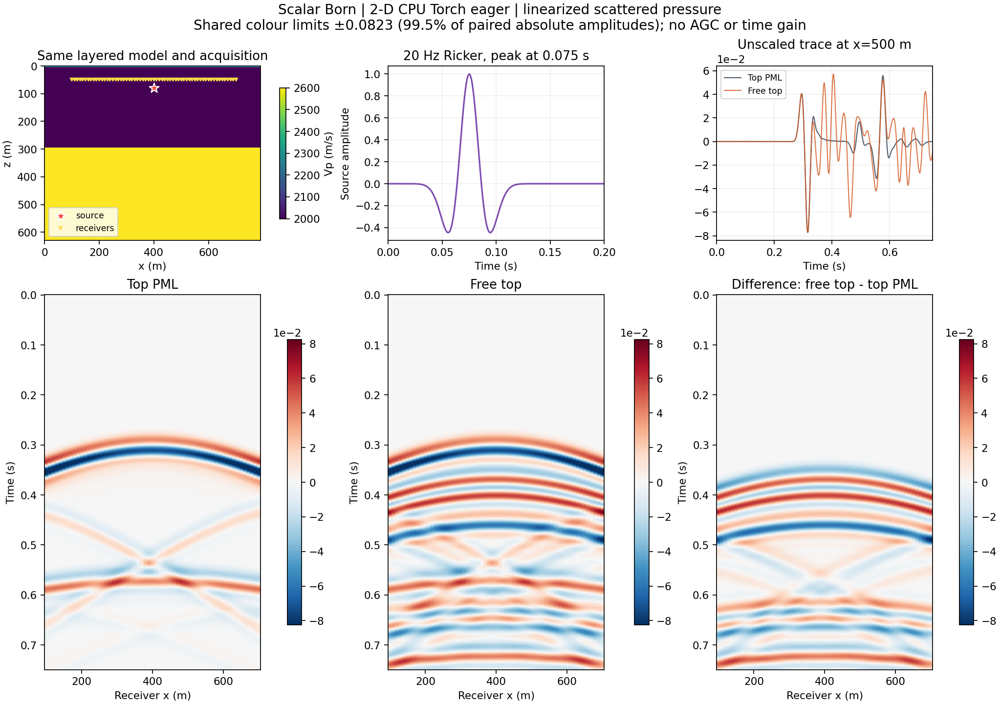
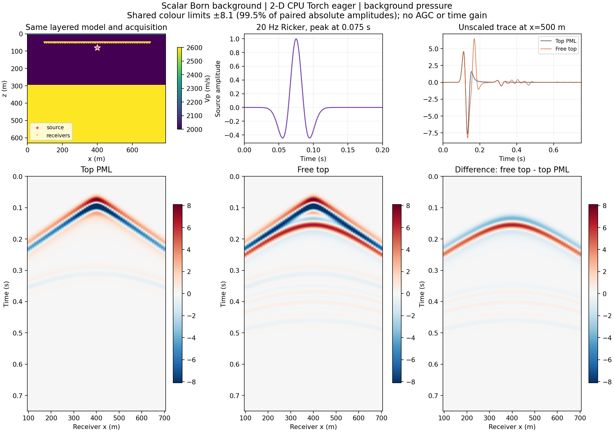
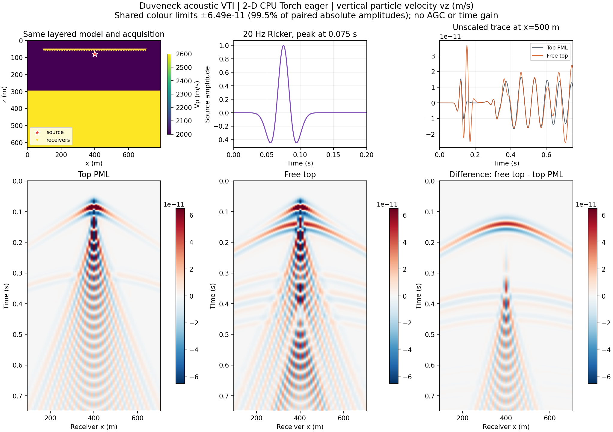
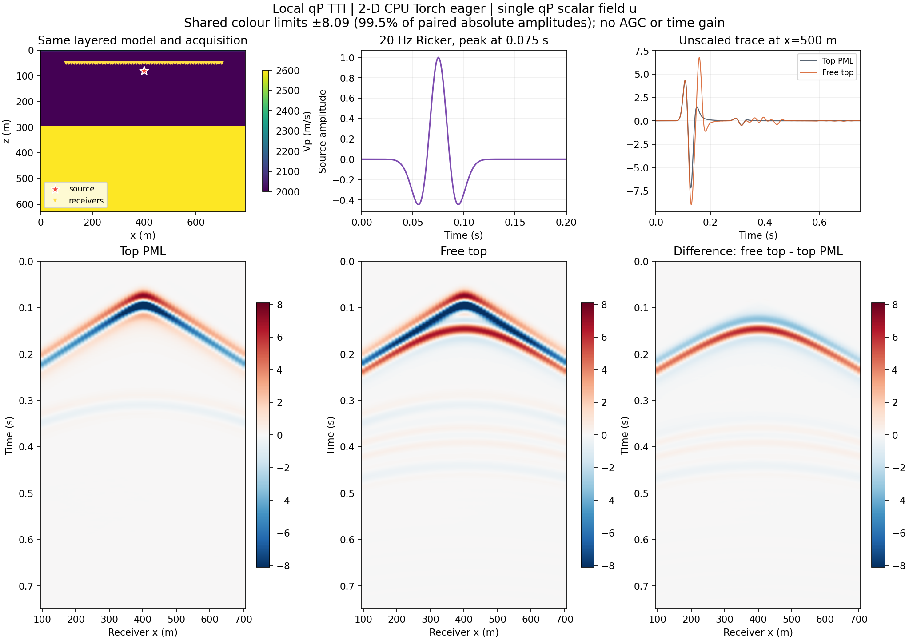
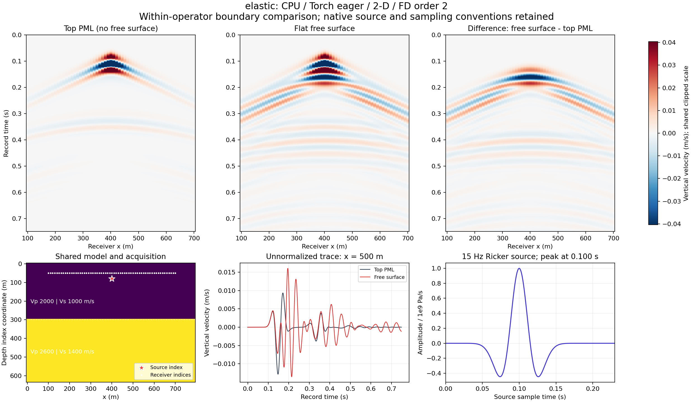
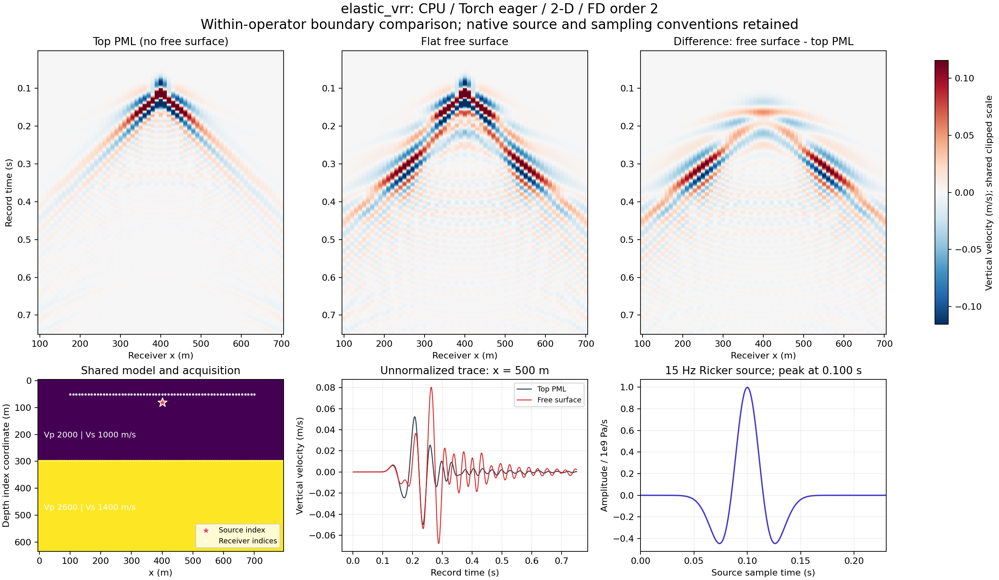
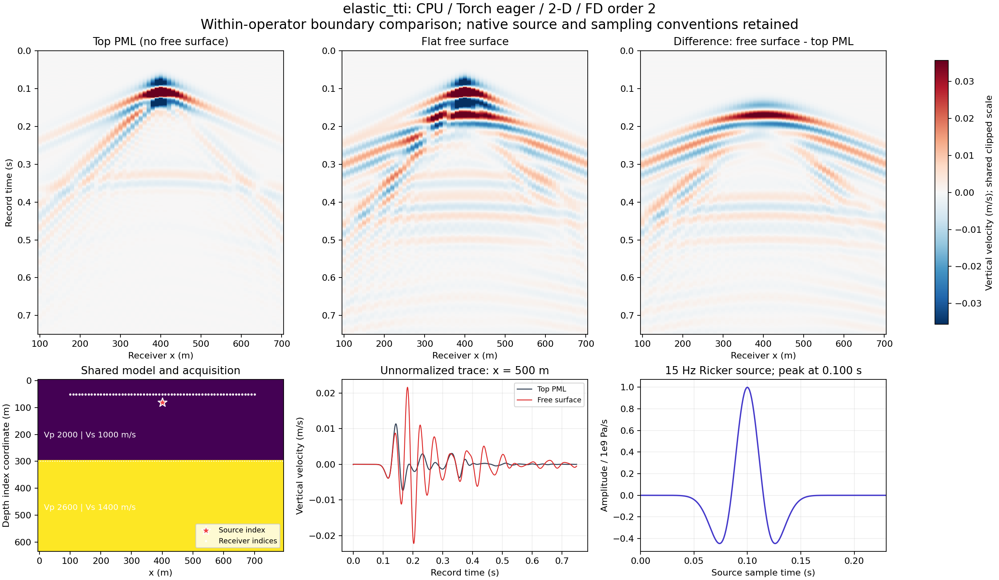
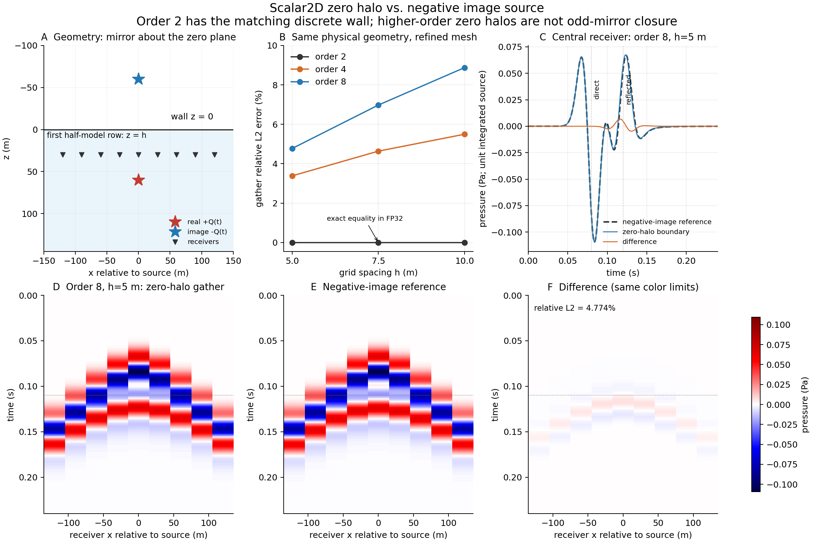

(free-surface)=
# 自由表面

本章集中说明各二维算子的平坦顶部边界，并给出同一算子在“顶部吸收边界”和“自由表面”设置下的 CPU 地震记录。这里的“自由表面”是入口名称，不代表所有算子采用同一离散闭合，也不代表所有记录都是压力。

```{important}
本章是开发源码的独立增补，对应 StarWave 提交 `200621cc31c0ebeebaa01ffaa3591c0ebd7e0adb`，不是对手册其余部分 V19/PyPI 契约的改写。所有示例均为二维、平坦顶部、CPU 运行；没有执行 CUDA 或三维算例。源码核对、CPU 配对运行、物理精度验收是不同证据。
```

(free-surface-meaning)=
## 边界条件与离散闭合

声学压力释放通常约束表面压力为零；弹性自由表面约束法向与切向牵引为零。有限差分中还必须说明约束落在哪个网格位置、虚点如何延拓、交错场如何排列，以及表面附近是否降低模板阶数。单独写“顶部 PML 宽度为零”不足以说明这些内容。

- 固定零 halo 把外部虚点保持为零，并不等于奇反射。它保留首个物理样点的更新，不能因为内点使用高阶模板，就宣称表面也具有同阶精度。
- 奇压力或奇应力延拓会反号镜像内部场；偶竖直面延拓不反号。它们必须与变量的交错位置和离散转置配套，不能跨算子照搬。
- 改进真空、投影本构与变分无牵引壁面是不同方案。不要把声学 VTI 或标量 qP TTI 的闭合解释为完整弹性 P/S 模式转换。

(free-surface-table)=
## 二维算子对照表

下表描述上述固定提交的实现。`A > 0`；逐面列表按模型轴的低侧、高侧排列。表内的 `z` 表示物理竖直方向，具体张量轴序仍按该入口。

| 算子 | 连续模型/边界目标 | 当前离散闭合 | 阶数与限制 |
|---|---|---|---|
| Scalar | 标量声学，平坦压力释放目标 `p=0` | 固定零外部 halo，首个物理样点活动；不是把 `p[0]` 固定为零 | 内点 `accuracy=2/4/6/8`；非奇镜像，不据此宣称同阶表面精度 |
| Born | 背景与线性化散射压力满足相应压力释放目标 | 两套场沿用固定零 FD ghost，首个物理样点活动 | 内点 `2/4/6/8`；散射场不是总场，边界高阶精度不由内点阶数保证 |
| 声学 VRZ | 速度/阻抗声学，平坦压力释放目标 `p=0` | 顶部无 PML/buffer，外部 `accuracy//2` 格固定零；首个物理行活动 | 内点 `2/4/6/8`；截断模板，不是奇反射 |
| 声学 VRR | 速度/矢量反射率声学，平坦压力释放目标 `p=0` | 固定零 halo、首个物理行活动 | 内点 `2/4/6/8`；连续变量变换不保证与 VRZ 的离散边界相同 |
| 声学 VTI | 声学法向牵引 `sV=0`，不要求 `sH=0` | 投影表面本构；法向应力奇延拓、竖直速度偶延拓 | 内点 `2/4/6/8`；拒绝表面含 `sV` 的震源；不是弹性 VTI |
| qP TTI | 局部近似 qP 标量压力释放 `u(x,0)=0` | 六个状态在表面及其上方投影；首 `M=accuracy//2` 个内部行使用二阶竖直导数 | 内点 `2/4/6/8`，近壁竖直模板二阶；非奇 ghost，不含弹性 qSV |
| Elastic | 各向同性弹性无牵引：`σ·n=0` | 改进真空；第 0 行固定真空，第 1 行是首个固体应力行 | 内点 `2/4/6/8`；不是在首个固体节点把所有应力同置零；不额外移动采集下标 |
| Elastic VRR | 动量/应力弹性系统的无牵引目标 | 固定真空行、真空刚度为零、法向面半质量 | 内点 `2/4/6/8`；边界离散不等于仅移除 PML；`pz` 不是 `vz` |
| Elastic TTI | 完整二维弹性 P–SV 的无牵引壁面 `σ·n=0` | 变分壁面在 `z=-dz/2`；局部 Schur 补凝聚壁面剪切应变，竖直壁面速度半质量 | 自由表面仅 `accuracy=2, coupling_order=2`；高阶明确拒绝，不静默降阶 |
| GSLS | 多机制黏声压力释放 `p(z=0)=0` | 奇压力、偶竖直面，离散 `H=-Gᵀ` 配对 | 内点 `2/4/6/8`；压力源须 `z>=1`；不是弹性无牵引条件 |

开启方式与轴序：Scalar/Born 将所选顶部面宽设为零；`[x,z]` 的声学 VRZ/VRR/VTI 使用 `[A,A,0,A]`。qP TTI 支持 `free_surface=True` 或合法顶部零宽列表。普通 Elastic 的竖直轴在前，使用 `[0,A,B,C]`；Elastic VRR 与 Elastic TTI 使用 `free_surface=True`。GSLS 为 `[z,x]`，使用 `[0,bottom,left,right]`。Elastic TTI 的 `pml_width=0` 单独出现只表示零延拓外部，不会开启自由表面。各入口对其余面宽及初始状态的约束仍须遵守。

各入口的模型、源与接收分量还受自己的约束。完整通用约定见[模型、采集与时间约定](conventions.md)，调用参数见 [Usage](../usage.md) 与 [PyTorch 后端](../pytorch-backend.md)。本章不扩展任何算子的设备或自动微分支持范围。

(free-surface-experiment)=
## 配对实验怎么做

每个算子都在同一个小型二维两层模型上运行两次：一次顶部为正宽 PML，一次使用该入口的平坦顶部闭合。每一对保留相同的物理模型、震源、接收位置、采样请求和侧面/底部吸收设置；只改变顶部边界所需的设置。由此产生的顶部扩展域、内部网格与时间步规划差异写入运行元数据，不人为伪装成完全相同的离散计算域。

图像按该算子的实际记录分量标注。每对“顶部吸收 / 自由表面”共享同一色标，差值由原始记录相减得到，不对两张炮集分别归一化。算子之间可能具有不同的源单位、场变量、分量和幅值尺度，因此不要按不同算子图像的亮度直接比较物理振幅。

实测公共设置为 `80×64` 个网格点、`dx=dz=10 m`、层界面深度 300 m、Vp=2000/2600 m/s，源名义位置 `(400,80) m`，61 道接收点位于 `x=100…700 m`、名义深度 50 m。请求 `dt=1 ms, nt=750`。全部使用 PyTorch `2.14.1+cpu`、`backend="torch", execution="eager", memory="full"`、float32、2 个 CPU 线程，未开启梯度。

Scalar/Born/VRZ/VRR/VTI/qP TTI/GSLS 使用四阶空间模板和 20 Hz Ricker；三种弹性示例使用二阶模板和 15 Hz Ricker，Elastic TTI 的 `coupling_order=2`。弹性 Vs=1000/1400 m/s、ρ=2000/2200 kg/m³。不同组的源幅度、PML 宽度和各向异性/衰减参数并不相同，详见每个 JSON；15 Hz 的弹性源是为避开该网格上 20 Hz 对应的 5 点 S 波长告警，不代表完成全频带色散或网格收敛验收。

除 Elastic TTI 外，9 个配对算子的内部时间步均为 `1 ms`、750 步、细分比 1；Elastic TTI 为 `0.5 ms`、1500 个内部步、细分比 2，公开输出仍为 750 个采样。VTI 与三种弹性图记录竖直粒子速度，qP TTI 记录其单场 `u`；Born 图记录线性化散射压力，其余声学图按各自源约定记录标量压力。时间也不跨算子强行统一：普通 Elastic 速度沿用 `(n-0.5)dt`，Elastic VRR 记录完成步 `dt…nt·dt`，Elastic TTI 对齐 `0…(nt-1)dt`。图轴和原始 `time_s` 保留各入口实际约定。

下方每张图都附原始 NPZ 与运行 JSON。NPZ 中 `absorbing`、`free_surface`、`difference` 分别保存顶部吸收记录、自由表面记录和后者减前者，`time_s` 与 `receiver_x_m` 给出坐标。Born 的额外背景场若保留在文件中，仍与散射记录分开命名。

(free-surface-records)=
## 各算子的实际 CPU 地震记录

以下差异展示指定算例对顶部边界的响应，不是误差图。无自由表面时的顶部 PML 也不是精确无限域解；将其中一条记录称为“真值”需要额外独立参考。

(free-surface-scalar)=
### Scalar：标量声学

记录标量场；其源缩放与压力的物理解释以此入口为准。固定零 halo 产生的反射不能改称为奇镜像。

```{raw} html
<figure class="sw-science-figure sw-free-surface-figure" data-operator="scalar">
  <a href="../_static/free-surface/scalar.png"></a>
  <figcaption>二维 CPU 配对记录。具体分量、源与网格设置以图中标注和运行元数据为准。 <a href="../_static/free-surface/scalar.npz">原始 NPZ</a> · <a href="../_static/free-surface/scalar.json">运行 JSON</a></figcaption>
</figure>
```

(free-surface-born)=
### Born：散射场

主图展示 Born 散射记录，不与背景记录混合。自由表面同时改变背景传播与散射传播，因此差值不只是一次孤立表面反射。

```{raw} html
<figure class="sw-science-figure sw-free-surface-figure" data-operator="born">
  <a href="../_static/free-surface/born.png"></a>
  <figcaption>二维 CPU 配对记录。具体分量、源与网格设置以图中标注和运行元数据为准。 <a href="../_static/free-surface/born.npz">原始 NPZ</a> · <a href="../_static/free-surface/born.json">运行 JSON</a></figcaption>
</figure>
```

```{raw} html
<figure class="sw-science-figure sw-free-surface-figure" data-operator="born_background">
  <a href="../_static/free-surface/born_background.png"></a>
  <figcaption>Born 背景记录，与上方线性化散射记录分开展示。两者的原始数组均在 Born NPZ 中。</figcaption>
</figure>
```

(free-surface-vrz)=
### VRZ：声学

保持相同速度与阻抗参数比较顶部闭合。顶部首个物理样点仍参与更新。

```{raw} html
<figure class="sw-science-figure sw-free-surface-figure" data-operator="vrz">
  <a href="../_static/free-surface/vrz.png"></a>
  <figcaption>二维 CPU 配对记录。具体分量、源与网格设置以图中标注和运行元数据为准。 <a href="../_static/free-surface/vrz.npz">原始 NPZ</a> · <a href="../_static/free-surface/vrz.json">运行 JSON</a></figcaption>
</figure>
```

(free-surface-vrr)=
### VRR：声学矢量反射率

声学 VRR 与弹性 VRR 是不同算子。这里比较声学标量记录，不将二者的变量或边界实现混为一谈。

```{raw} html
<figure class="sw-science-figure sw-free-surface-figure" data-operator="vrr">
  <a href="../_static/free-surface/vrr.png"></a>
  <figcaption>二维 CPU 配对记录。具体分量、源与网格设置以图中标注和运行元数据为准。 <a href="../_static/free-surface/vrr.npz">原始 NPZ</a> · <a href="../_static/free-surface/vrr.json">运行 JSON</a></figcaption>
</figure>
```

(free-surface-vti)=
### VTI：声学投影闭合

本图记录竖直速度 `vz`，接收下标 z=5 对应原生半格位置 55 m，不是整数压力节点的 50 m。表面 sV 为零不意味着地下所有应力为零。两种边界的记录都包含声学 VTI 额外分支相关的慢波/尾波，不能据此标作 Rayleigh 波，也不能把所有晚到都归为自由表面多次波；事件模式需要独立参考识别。

```{raw} html
<figure class="sw-science-figure sw-free-surface-figure" data-operator="vti">
  <a href="../_static/free-surface/vti.png"></a>
  <figcaption>二维 CPU 配对记录。具体分量、源与网格设置以图中标注和运行元数据为准。 <a href="../_static/free-surface/vti.npz">原始 NPZ</a> · <a href="../_static/free-surface/vti.json">运行 JSON</a></figcaption>
</figure>
```

(free-surface-tti)=
### TTI：局部近似 qP

此处为单场局部 qP 近似，不是完整弹性 TTI。表面状态投影与近壁二阶竖直模板必须一起理解。

```{raw} html
<figure class="sw-science-figure sw-free-surface-figure" data-operator="tti">
  <a href="../_static/free-surface/tti.png"></a>
  <figcaption>二维 CPU 配对记录。具体分量、源与网格设置以图中标注和运行元数据为准。 <a href="../_static/free-surface/tti.npz">原始 NPZ</a> · <a href="../_static/free-surface/tti.json">运行 JSON</a></figcaption>
</figure>
```

(free-surface-elastic)=
### Elastic：改进真空

真空行保持原网格坐标。实际输出分量及其交错位置见图注和运行 JSON；不要把速度记录直接称为压力。

```{raw} html
<figure class="sw-science-figure sw-free-surface-figure" data-operator="elastic">
  <a href="../_static/free-surface/elastic.png"></a>
  <figcaption>二维 CPU 配对记录。具体分量、源与网格设置以图中标注和运行元数据为准。 <a href="../_static/free-surface/elastic.npz">原始 NPZ</a> · <a href="../_static/free-surface/elastic.json">运行 JSON</a></figcaption>
</figure>
```

(free-surface-elastic_vrr)=
### Elastic VRR：动量与应力

半质量法向面属于边界离散。若输出速度，由动量除以对应面密度得到；若输出 pz，则仍是动量。

```{raw} html
<figure class="sw-science-figure sw-free-surface-figure" data-operator="elastic_vrr">
  <a href="../_static/free-surface/elastic_vrr.png"></a>
  <figcaption>二维 CPU 配对记录。具体分量、源与网格设置以图中标注和运行元数据为准。 <a href="../_static/free-surface/elastic_vrr.npz">原始 NPZ</a> · <a href="../_static/free-surface/elastic_vrr.json">运行 JSON</a></figcaption>
</figure>
```

(free-surface-elastic_tti)=
### Elastic TTI：变分无牵引壁面

配对实验固定使用 accuracy=2 与 coupling_order=2，壁面位于首个正应力节点上方半格。不要以默认高阶导数替代此合法组合。

```{raw} html
<figure class="sw-science-figure sw-free-surface-figure" data-operator="elastic_tti">
  <a href="../_static/free-surface/elastic_tti.png"></a>
  <figcaption>二维 CPU 配对记录。具体分量、源与网格设置以图中标注和运行元数据为准。 <a href="../_static/free-surface/elastic_tti.npz">原始 NPZ</a> · <a href="../_static/free-surface/elastic_tti.json">运行 JSON</a></figcaption>
</figure>
```

(free-surface-gsls)=
### GSLS：多机制黏声

两次运行保留相同衰减模型，比较的是顶部边界，不是有耗与无耗对照。本例采用 hao1、5 个机制、名义 Q₀=60、设计频带 1–200 Hz、参考频率 20 Hz；实际 Q_eff(20 Hz)≈60.1720，带内最大相对逆 Q 拟合误差约 11.1017%，原拟合告警保留，不称为精确恒 Q=60。奇压力与偶竖直面必须保留离散转置配对。

```{raw} html
<figure class="sw-science-figure sw-free-surface-figure" data-operator="gsls">
  <a href="../_static/free-surface/gsls.png"></a>
  <figcaption>二维 CPU 配对记录。具体分量、源与网格设置以图中标注和运行元数据为准。 <a href="../_static/free-surface/gsls.npz">原始 NPZ</a> · <a href="../_static/free-surface/gsls.json">运行 JSON</a></figcaption>
</figure>
```


(free-surface-mirror)=
## 镜像震源：怎样独立检查压力释放

对于平坦压力释放面，把真实震源放在壁面一侧，在另一侧放置关于壁面镜像的震源，并令其振幅反号。均匀介质中，或材料系数、离散模板与外侧处理都关于壁面对称延拓时，全空间“真实源 + 负镜像源”的限制解可作为半空间压力释放参考。镜像坐标是 `z_image = 2*z_wall - z_source`，不是无条件把数组下标取负。该构造不能直接替代弹性无牵引壁面的 P/S 转换解，也不适用于未经对称延拓的一般非均匀模型。

本次另做了真正的 Scalar CPU 镜像试验，而不只检查壁面样点为零：速度 1500 m/s，物理壁面 `z=0`，源在 `(0,60 m)`，负镜像源在 `(0,-60 m)`，9 个接收点位于 `z=30 m, x=-120…120 m`。使用 25 Hz Ricker、`dt=0.5 ms`，比较 `0–0.24 s` 内的原始压力记录。半空间首个活动样点的坐标明确定义为 `z=h`，因此 Scalar 二阶零 halo 的等效壁面与全空间镜像平面一致。外侧最短几何返回时间不小于 0.32 s；把外侧范围从 300 m 加到 360 m 的附加控制，在该时间窗内未改变被检查的记录。

完整炮集相对 L2 差如下，分母为对应全空间镜像记录的范数：

| 内点阶数 | h=10 m | h=7.5 m | h=5 m |
|---|---:|---:|---:|
| 2 | 0 | 0 | 0 |
| 4 | 5.496% | 4.638% | 3.384% |
| 8 | 8.876% | 6.977% | 4.774% |

二阶在本次浮点运算和时间窗内逐样点一致，验证了这组壁面位置、源反号与离散对称接线，不是连续解无误差的证明。四阶、八阶的固定零 halo 并非奇延拓，仍有可见波形差异；加密后差异缩小，但这三组网格不能证明达到四阶或八阶表面收敛。尤其不能用二阶结果给所有高阶或其他算子盖章。四阶和八阶各自比较同阶全空间参考，八阶差值较大是在衡量边界闭合差异，不是证明八阶内点传播本身比四阶更差。

```{raw} html
<figure class="sw-science-figure sw-free-surface-figure" data-validation="scalar_mirror">
  <a href="../_static/free-surface/scalar_mirror.png"></a>
  <figcaption>单独的均匀介质镜像验证，不是第 11 个顶部吸收/自由表面算子配对。全空间参考使用相同内点有限差分，不是独立连续解析求解器。<a href="../_static/free-surface/scalar_mirror.npz">原始 NPZ</a> · <a href="../_static/free-surface/scalar_mirror.json">验证 JSON</a></figcaption>
</figure>
```

(free-surface-verification)=
## 每类算子还应怎样验收

“表面值为零”“反向传播能运行”和“两个后端一致”都不是完整物理验收。下面是各类算子的建议验证矩阵；除上一节的 Scalar 镜像试验之外，这些专项验收没有作为本次配对展示全部执行，也不能读成全部通过。

| 算子 | 独立物理或离散参考 | 应同时检查 |
|---|---|---|
| Scalar | 均匀介质负镜像源；固定壁面网格加密；水平层状介质参考 | 到时、相位、反射振幅与多次波；区分内点色散和表面误差 |
| Born | 相同边界下背景传播器对模型扰动的有限差分/线性化 | 散射随扰动的线性标度、残差阶数、源项导数；Born 不含扰动的任意阶多重散射 |
| VRZ / 声学 VRR | 使用相同物理速度、密度、阻抗及一致离散反射率构造，与相应变密度声学基准比较 | 对齐源单位、观测量、网格和壁面；不将连续代数等价当作离散等价 |
| 声学 VTI | 各向同性极限、独立各向异性参考或制造解 | 法向牵引闭合、近表面反射相位和振幅、各向异性参数范围；不要求该声学模型产生真实弹性 qSV |
| qP TTI | 各向同性/零倾角控制；该局部近似方程的独立参考及加密 | 标量压力释放、近壁阶数与倾角依赖；不拿完整弹性解误作相同 PDE 的逐点真值 |
| Elastic / Elastic VRR | 各向同性斜入射 P/S 反射系数、独立半空间/Lamb 或 Rayleigh 参考 | 交错位置上的法向/切向牵引残差、模式转换、表面波、长期稳定性；VRR 还须物理一致的反射率和面密度 |
| Elastic TTI | 各向同性极限与独立各向异性 P/S 半空间参考；制造解 | 半格壁面、变分闭合与牵引残差；当前自由表面仅验收二阶/耦合二阶组合 |
| GSLS | 均匀衰减介质的对称镜像/频域参考、无耗极限 | 压力释放、频散与衰减、松弛变量演化及参数梯度；`H=-Gᵀ` 与点积测试只覆盖离散代数的一部分 |

所有测试都需要预先声明误差量、时间窗、网格、容差和参考的独立性。层状或复杂模型中的额外波列可以是合理的自由表面多次波，但不能仅凭视觉给每个事件作模式归属。

(free-surface-interpretation)=
## 能说明什么，不能说明什么

这些算例可以确认指定源码、后端与参数下实际生成了可比较的有限记录，并观察顶部条件改变后出现的反射、干涉与后续波列。它们不能单独证明：表面阶数、任意倾角或介质下的正确反射系数、长期稳定性、伴随与梯度正确性，或 CUDA 与 CPU 的一致性。

尤其是 Scalar/Born/VRZ/VRR 的零 halo 与奇镜像并不等价。本页不通过“图像看起来合理”回避这种差别。若要验收表面精度，应另做固定物理壁面位置的解析/制造解比较、网格加密、斜入射反射系数和足够长时间的稳定性试验，并明确包含哪些 PML、源与采样误差。

本页只包含平坦顶部，不支持据此推断起伏地形自由表面。二维案例也不能作为任何三维实现的验收证据。

(free-surface-reproduce)=
## 数据与复现边界

下载[总清单](../_static/free-surface/manifest.json)核对源提交、每个算子的后端、dtype、文件大小和 SHA-256；各算子的运行 JSON 给出具体模型、采集、时间步、边界与范数。复现时使用匹配源码和记录中的参数，而不是假定当前安装的 wheel 具备相同接口。

复现脚本：[声学七算子](https://github.com/StarrMoonn/StarWave-docs/blob/main/tools/run_free_surface_acoustic.py)、[弹性三算子](https://github.com/StarrMoonn/StarWave-docs/blob/main/tools/run_free_surface_elastic.py)、[Scalar 镜像试验](https://github.com/StarrMoonn/StarWave-docs/blob/main/tools/run_scalar_mirror.py)。脚本使用正常的 `import starwave`；先安装与本章固定提交匹配的源码。命令及输出路径以各脚本的 `--help` 为准。

这些数值文件是 CPU 实验结果，不包含 StarWave 内核源码。本次文档增补不更改稳定内核，也不代表发布了新的 PyPI 二进制。

(free-surface-source)=
## 实现依据

实现说明固定到同一提交，避免以后默认分支变化造成含义漂移：

- [Scalar 公共契约](https://github.com/StarrMoonn/StarWave/blob/200621cc31c0ebeebaa01ffaa3591c0ebd7e0adb/starwave/scalar.py)与[逐面固定零边界说明](https://github.com/StarrMoonn/StarWave/blob/200621cc31c0ebeebaa01ffaa3591c0ebd7e0adb/docs/reference/SCALAR_FACE_BOUNDARIES.md)。
- [Born 公共接口](https://github.com/StarrMoonn/StarWave/blob/200621cc31c0ebeebaa01ffaa3591c0ebd7e0adb/starwave/scalar_born.py)与 [Born 指南](https://github.com/StarrMoonn/StarWave/blob/200621cc31c0ebeebaa01ffaa3591c0ebd7e0adb/docs/guides/BORN_DEEPWAVE.md)。
- [qP TTI 公共契约](https://github.com/StarrMoonn/StarWave/blob/200621cc31c0ebeebaa01ffaa3591c0ebd7e0adb/starwave/tti.py)及[近壁参考更新](https://github.com/StarrMoonn/StarWave/blob/200621cc31c0ebeebaa01ffaa3591c0ebd7e0adb/starwave/_tti_reference.py)。
- [Elastic 改进真空准备](https://github.com/StarrMoonn/StarWave/blob/200621cc31c0ebeebaa01ffaa3591c0ebd7e0adb/starwave/_elastic_free_surface.py)与 [Elastic VRR 真空/半质量闭合](https://github.com/StarrMoonn/StarWave/blob/200621cc31c0ebeebaa01ffaa3591c0ebd7e0adb/starwave/_elastic_vr_free_surface.py)。
- [Elastic TTI 公共契约](https://github.com/StarrMoonn/StarWave/blob/200621cc31c0ebeebaa01ffaa3591c0ebd7e0adb/starwave/elastic_tti.py)。
- [VTI 投影与镜像差分](https://github.com/StarrMoonn/StarWave/blob/200621cc31c0ebeebaa01ffaa3591c0ebd7e0adb/starwave/torch_backend/_vti_portable.py)与 [GSLS 的离散转置闭合](https://github.com/StarrMoonn/StarWave/blob/200621cc31c0ebeebaa01ffaa3591c0ebd7e0adb/starwave/torch_backend/_gsls_free_surface.py)。

源码中的契约与测试入口是实现证据，不等于本次已执行了所有测试。已执行范围以本页实际运行元数据为准。
